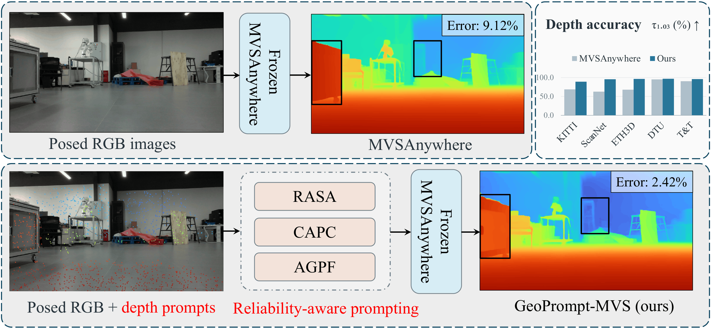

# geoprompt-mvs
Official repository for the paper "Reliability-Aware Training-Free Geometric Prompting for Frozen MVS".

The source code will be released upon publication.

## Selected Results

The figure previews **GeoPrompt-MVS**, a training-free geometric prompting framework that uses sparse metric depth observations with a frozen MVS model. It shows the reliability-aware prompting components (RASA, CAPC, and AGPF), a representative depth prediction compared with the frozen MVSAnywhere baseline, and a depth-accuracy summary across KITTI, ScanNet, ETH3D, DTU, and T&T. These are selected illustrations of the method and results presented in the paper.

